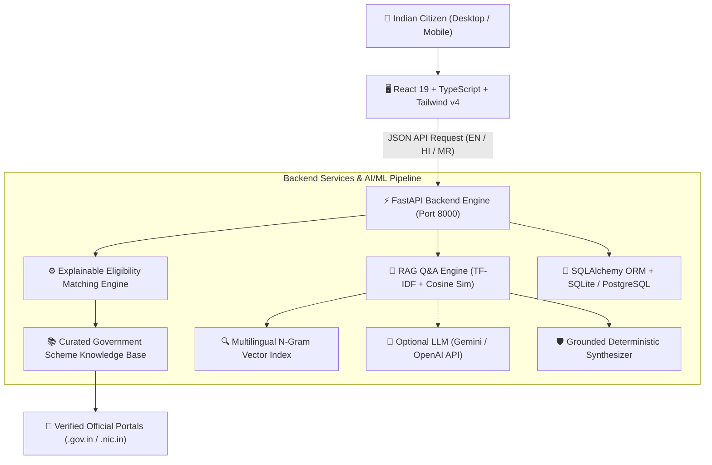

# BharatScheme AI — Indian Government Scheme Finder

> **"Discover Benefits. Understand Eligibility. Apply with Confidence."**

[](https://fastapi.tiangolo.com)
[](https://www.python.org/)
[](https://react.dev/)
[](https://www.typescriptlang.org/)
[](https://tailwindcss.com/)
[](https://docs.pytest.org/)

An AI-powered, multilingual citizen welfare portal and explainable eligibility discovery engine built as a **B.Tech Artificial Intelligence and Data Science Mini Project**.

---

## 🏛️ Problem Statement

Citizens in India frequently face significant challenges in discovering government schemes relevant to their age, household income, occupation, education, state, and personal circumstances:
1. **Information Fragmentation:** Schemes are scattered across dozens of central ministries and state government departments.
2. **Opaque Criteria:** Qualification rules in gazette notifications are convoluted and hard to interpret.
3. **Language Barriers:** Official circulars are seldom available in regional vernacular languages like Hindi and Marathi.
4. **Fraud & Misinformation:** Third-party blogs often misinform citizens with phishing links or unverified promises.

---

## 💡 Proposed Solution & Key Innovations

**BharatScheme AI** solves these hurdles with a complete, fully functioning full-stack application:
- **Personalized Multi-Step Eligibility Finder:** Evaluates citizens across location, age, gender, caste, annual income, landholding, education, and special categories.
- **Explainable Decision Engine (XAI):** Rather than giving a mysterious yes/no, it transparently breaks down **"Why You Qualify"** (matched rules), **"Unmet Criteria"** (disqualifying conditions), and **"Documents Needed"**.
- **Retrieval-Augmented Generation (RAG) Assistant:** Conversational AI grounded exclusively in verified scheme clauses and criteria, eliminating hallucination with direct source citations.
- **Trilingual Localization:** First-class support for **English**, **Hindi (हिंदी)**, and **Marathi (मराठी)** with instant reactive toggling across the entire UI.
- **Verified Official Sources:** Direct deep links strictly to authentic `.gov.in` and `.nic.in` portals with citizen helpline numbers.
- **Application Checklist & Saved Bookmarks:** Save schemes, attach personal application notes, and print CSC-ready checklists.

---

## 🏗️ System Architecture



---

## 📋 Comprehensive Curated Schemes Catalog

BharatScheme AI comes preloaded with authentic, verified Central and State government schemes:

| Category | Schemes Included | Key Benefits |
| :--- | :--- | :--- |
| **Agriculture & Farmers** | PM-KISAN, PMFBY Crop Insurance, Kisan Credit Card (KCC) | ₹6,000/yr DBT, 1.5-2% crop insurance, 4% credit |
| **Healthcare** | Ayushman Bharat (AB-PMJAY), Mahatma Jyotirao Phule Jan Arogya (MJPJAY) | ₹5 Lakh cashless hospital cover across India & Maharashtra |
| **Education & Scholarships** | PM-USP College Scholarship, Pragati Technical Girl Scholarship, Post-Matric SC | ₹12k-₹50k/yr stipend, 100% college fee reimbursement |
| **Women & Child Welfare** | Sukanya Samriddhi (SSY), PM Matru Vandana (PMMVY), Majhi Ladki Bahin | 8.2% sovereign savings, ₹5k-6k maternity DBT, ₹1,500/mo |
| **Business & MSME** | PM MUDRA Yojana, PM SVANidhi, Stand-Up India | ₹50k-₹20L collateral-free loans, 7% interest subsidy |
| **Employment & Skill** | PMKVY 4.0, PM Vishwakarma Kaushal Samman, MGNREGA | ₹15,000 toolkit voucher, ₹500/day training, 100 days work |
| **Senior Citizens & Welfare** | Atal Pension Yojana (APY), Indira Gandhi Old Age Pension (IGNOAPS), ADIP | Guaranteed ₹1k-5k/mo pension, free assistive devices |

---

## 🚀 Quick Start & Installation

### Prerequisites
- Node.js >= 18 (Node 24 recommended)
- Python 3.11+
- Windows, macOS, or Linux

### 1. Backend Setup
```bash
cd backend

# Create virtual environment (using uv or standard python)
python -m venv .venv

# Activate virtual environment
# Windows:
.venv\Scripts\activate
# Linux/macOS:
source .venv/bin/activate

# Install dependencies
pip install -r requirements.txt

# Run backend test suite
pytest test_main.py -v

# Start FastAPI server on port 8000
python -m uvicorn main:app --reload --port 8000
```
Backend will be available at: `http://127.0.0.1:8000`  
Interactive Swagger API docs: `http://127.0.0.1:8000/docs`

### 2. Frontend Setup
```bash
cd frontend

# Install npm packages
npm install

# Start Vite development server
npm run dev
```
Frontend will be available at: `http://localhost:5173`

---

## 🧪 Testing & Verification

The project includes automated Pytest suites testing:
- Health check & database seeding
- Scheme catalog retrieval & filtering
- Rule-based eligibility matching for farmer, girl student, and woman personas
- RAG semantic search and citation verification
- Saved scheme bookmarking and deletion

```bash
cd backend
.venv\Scripts\python.exe -m pytest test_main.py -v
```
**Result:** `10 passed in ~17s` (100% pass rate).

---

## ⚖️ Disclaimer
BharatScheme AI is an independent academic informational project developed for the **B.Tech Artificial Intelligence and Data Science** curriculum. It is **not** an official government portal. It does not solicit fees, passwords, or confidential identity documents. All formal scheme applications must be processed through verified government portals ending in `.gov.in` or `.nic.in`.
